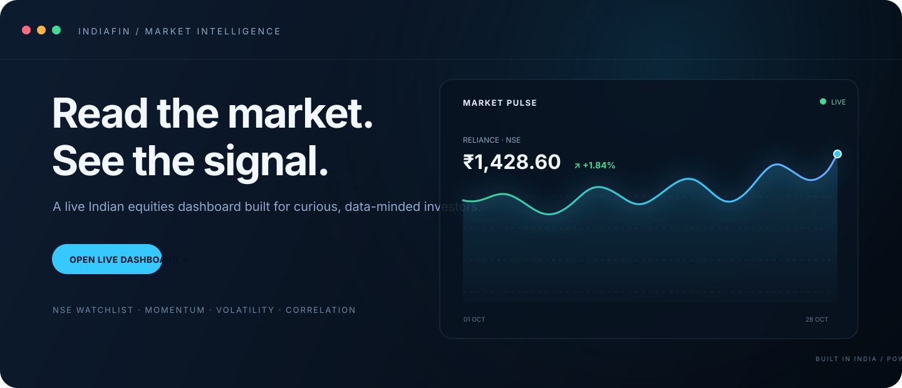
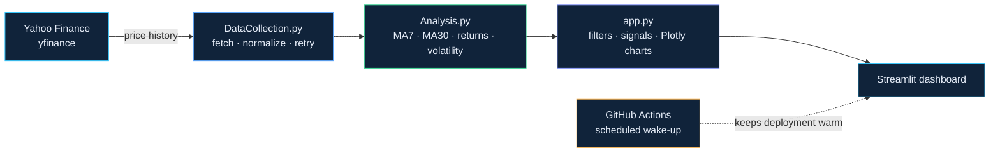

<p align="center">
  
</p>

<p align="center">
  <a href="https://indiafin.streamlit.app/"><strong>↗ Open the live dashboard</strong></a>
  &nbsp;·&nbsp; Built with Python + Streamlit &nbsp;·&nbsp; Focused on Indian equities
</p>

<p align="center">
  
  
  
  
</p>

<h1 align="center">IndiaFin</h1>
<p align="center"><em>A small market desk for exploring the movement behind Indian stocks.</em></p>

IndiaFin turns recent price history into a focused, interactive view of momentum, volatility, trading activity, and relationships across a hand-picked Indian equities watchlist. Pick a stock, set the time window, and follow the signals through the charts.

> **For exploration, not investment advice.** Prices are fetched through Yahoo Finance via `yfinance`; availability, timing, and coverage depend on that upstream service. This project is not an exchange feed or a trading system.

## The market desk

| At a glance | What you can explore |
|:--|:--|
| **Price & daily move** | Latest close and daily return for the selected stock |
| **Trend & momentum** | Closing price against 7-day and 30-day moving averages |
| **Volatility** | Rolling 7-day standard deviation of daily returns |
| **Trading activity** | Daily reported volume across the selected period |
| **Cross-stock context** | Correlation matrix of daily returns across the watchlist |

The dashboard has a dark, low-glare trading-desk look, with blue and cyan chart lines, green positive movement, and amber secondary signals. The stock selector and 1-, 3-, and 6-month windows are interactive in the app.

## Watchlist

Reliance · TCS · Eternal (formerly Zomato) · Infosys · HDFC Bank · Adani Ports · Wipro · ITC

Tickers are mapped to Yahoo Finance symbols in [`DataCollection.py`](DataCollection.py). Availability can vary by symbol and provider response.

## Under the hood



<details>
<summary><strong>What the dashboard calculates</strong></summary>

- **MA7 / MA30:** rolling means of closing price over 7 and 30 trading observations.
- **Daily return:** close-to-close percentage change.
- **Volatility:** rolling 7-observation standard deviation of daily returns.
- **Momentum note:** compares MA7 with MA30; this is a simple descriptive signal, not a forecast.
- **Correlation:** pairwise correlation of daily percentage returns across available tickers. Values near +1 move together, near 0 have a weaker linear relationship, and near −1 tend to move in opposite directions.

</details>

<details>
<summary><strong>Project map</strong></summary>

| File | Role |
|:--|:--|
| [`app.py`](app.py) | Streamlit interface, filters, insights, and Plotly charts |
| [`DataCollection.py`](DataCollection.py) | Yahoo Finance retrieval, normalization, and retries |
| [`Analysis.py`](Analysis.py) | Time-series features and per-ticker analysis |
| [`streamlit_app.py`](streamlit_app.py) | Streamlit entry point |
| [`wake_up_streamlit.py`](wake_up_streamlit.py) | Deployment wake-up helper |
| [`.github/workflows/keep_alive.yml`](.github/workflows/keep_alive.yml) | Scheduled GitHub Actions workflow |
| [`assets/indiafin-hero.svg`](assets/indiafin-hero.svg) | Custom dashboard-inspired README artwork |

</details>

## Run it locally

**You’ll need Python 3.11 or newer.**

```bash
git clone https://github.com/varunNeon/IndiaFin.git
cd IndiaFin
python -m venv .venv

# macOS / Linux
source .venv/bin/activate

# Windows PowerShell
# .venv\Scripts\Activate.ps1

python -m pip install -r requirements.txt
streamlit run app.py
```

Streamlit prints a local URL (usually `http://localhost:8501`). Market data is requested when the app loads; if the provider is unavailable, try again later.

## Build notes

- **Python** handles retrieval and time-series feature engineering.
- **pandas** shapes and analyzes the market data.
- **yfinance** supplies historical price data.
- **Streamlit** provides the interactive app and **Plotly** renders its charts.
- **Streamlit Community Cloud** hosts the live demo; **GitHub Actions** runs the configured wake-up schedule.

## Ideas on the radar

- [ ] Download selected chart data as CSV
- [ ] Add sector tags and sector-level comparison
- [ ] Let users compare two tickers on a normalized return chart
- [ ] Add a clear data freshness timestamp

---

<p align="center"><sub>Made for learning, tinkering, and a closer look at market behavior. IndiaFin is not affiliated with NSE or Yahoo Finance.</sub></p>
